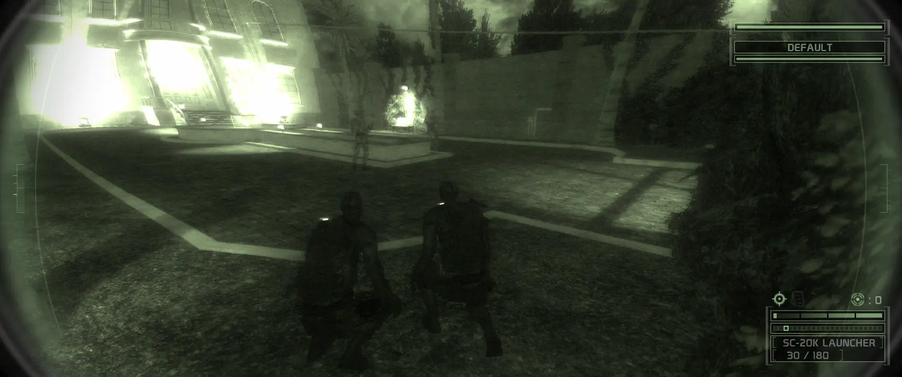
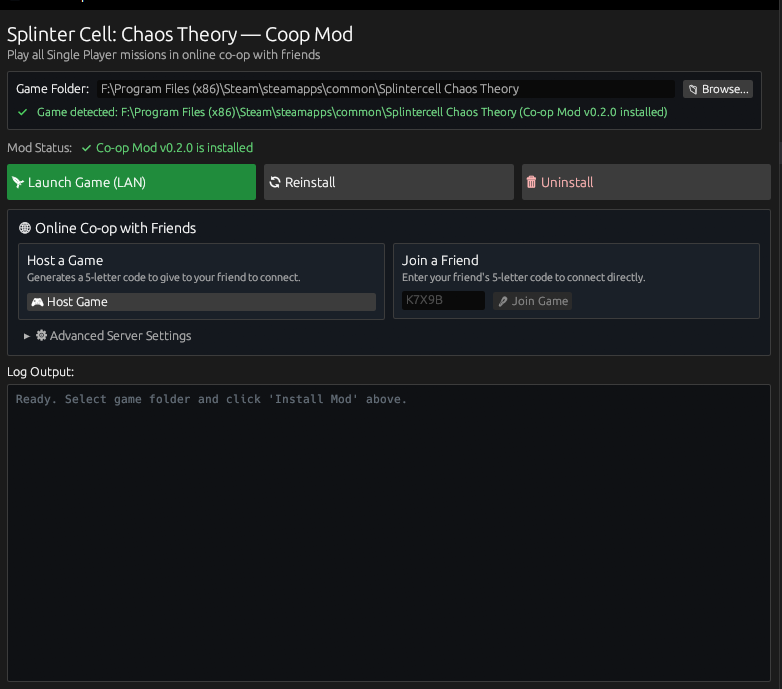

# Splinter Cell: Chaos Theory — Enhanced Coop



Mod for Splinter Cell: Chaos Theory (SCCT) to **play all levels in coop mode including single player levels**. Also, you can **play over the internet** and no longer require LAN or virtual LANs like Hamachi/ZeroTier.

This mod is 100% free and open source.

All features:

- Play online via internet: you and your friend join each other with a 5-character friend code.

- Play all single player levels in coop.

- Fix LAN connectivity. SCCT has an old bug where it can broadcast the wrong IP address. That caused you to be unable to connect even though you were on LAN or a virtual LAN like Hamachi/Zerotier

- Quick saves in coop are now persistent: you can load a quick save made in a previous session even after quitting and restarting the game (both players must launch via `scct_coop_enhancer`; the Host starts the level normally, pauses, and presses 'Quick Load').

- Remote EEV hacking is available in coop

- Alt-tab readiness fix: a player alt-tabbing no longer unreadies you in the coop mission screen.

- ESC menu readiness fix: if you pause the game, both players are 'ready' to resume or quick save by default to save time.

## How to use

You must have a valid copy of Splinter Cell Chaos Theory for it to work, e.g. via Steam.

1. (Both) Download the latest SCCT Coop Enhancer version from [the releases](https://github.com/sholtrop/scct_enhanced_coop/releases):
   `scct_coop_enhancer-<version>.exe` (e.g. `scct_coop_enhancer-1.0.0.exe`).

2. (Both) Run the executable. You will get a Windows Defender warning about this being a trojan. That is expected; this mod edits SCCT's memory and opens network ports. That triggers Windows Defender. If this happens, you will have to exempt this .exe in Windows Defender.

   If you do not trust the .exe, upload it to [VirusTotal](https://www.virustotal.com/gui/home/upload) and you'll see only one vendor (SecureAge) complaining.

3. (Both) You will see this UI: 

   Locate your Splinter Cell Chaos Theory installation and click 'Install Mod'.

4. One of you must click "Host Game". That person will get a 5-character friend code.

5. The other person must enter this friend code under "Join a Friend" and click "Join Game". You should now both see that you are connected.

6. (Both) Click "Launch Game (Co-op)".

7. In game, go to Coop -> Enhanced Coop. One of you can create a game (doesn't matter who) and the other can join.

> [!NOTE]
> To see single player levels, you have to scroll down in the level select

## FAQ

**Q**: We get disconnected, what to do about that?

**A**: Disconnects can happen for two reasons

1. Network issues. If this happens while playing via internet (i.e. friend code), you can try Hamachi/Zerotier and play via (virtual) LAN.
2. Your game and your friend's game have diverged. This is usually a bug. In this case, SCCT Enhanced Coop will make a dump for you that can help identify the issue. Please [make an issue](https://github.com/sholtrop/scct_enhanced_coop/issues) and attach `System/scct_startup_trace*.txt` and `System/scct_desync_dump*.txt` from both peers to it. I will see if I can reproduce and fix it.

**Q**: We get stuck or soft-locked in a level

**A**: Please [make an issue](https://github.com/sholtrop/scct_enhanced_coop/issues) describing it. As a workaround, in some cases, one of you can deliberately fall to their death so the other can resurrect them.

## Developing

To develop and test locally, it can be convenient to run two instances of SCCT locally. Both instances must have their own IP address since the game's ports are hard-coded. Here is what I use:

1. Download [Sandboxie](https://sandboxie-plus.com/).
2. Make a HyperV virtual switch with its own IP address.
3. Download [Fusion Fix](https://fusionfix.io/games/scct/) and configure it to run SCCT in _borderless fullscreen_. Important because if the game alt-tabs, you will get desynchronized and disconnected.
4. Start two `scct_coop_enhancer` instances: one normally and one inside Sandboxie
5. Make sure they both use their own IP address. One can use your regular IP address, the other your HyperV virtual switch's IP address.
6. Launch two SCCT instances

## Technical docs

This _SCCT Enhanced Coop_ mod consists of two parts:

1. **`scct_coop_server`**: A small STUN server and HTTP signaling rendezvous server. Used only for room code pairing and NAT hole-punching. Written in Rust + Axum.
2. **`scct_coop_enhancer`**: A desktop GUI launcher that handles mod installation, game launch, STUN hole-punching, in-memory runtime hooks. Written in Rust + egui.

### SCCT Coop Enhancer

The `scct_coop_enhancer` can be launched in GUI mode (default) or used headlessly from the command line:

```bash
# Host a match headlessly (generates a Friend Code, waits for partner, and launches game)
scct_coop_enhancer --host

# Join a match headlessly using your partner's Friend Code
scct_coop_enhancer --join <CODE>

# Launch the game in LAN mode headlessly with multi-NIC fixes applied
scct_coop_enhancer --lan

# Configure peer target without auto-launching game (e.g. for Proton / Wine / Steam custom launch)
scct_coop_enhancer --host --no-launch
scct_coop_enhancer --join <CODE> --no-launch

# Show per-feature patch toggles in the GUI
scct_coop_enhancer --dev

# Bind sockets and game LAN traffic to a specific local IPv4 adapter address
scct_coop_enhancer --bind-ip <IP>

# Enable experimental Host -> Client in-memory auto-resync on checksum mismatch
scct_coop_enhancer --resync

# Specify custom game folder or rendezvous/STUN server
scct_coop_enhancer --game-dir <PATH>
scct_coop_enhancer --server-host <HOST> --stun-port <PORT> --api-port <PORT>

# Apply mod patches headlessly without opening the GUI
scct_coop_enhancer --cli

# Restore 100% vanilla game files
scct_coop_enhancer --restore
```

### SCCT Coop Server

The `scct_coop_server` is needed to match friend codes and perform STUN. Without one, you can only play on LAN. I host an `scct_coop_server` at https://scct_coop.sholtrop.dev, completely free to use. The `scct_coop_enhancer` uses that one by default, but you can use a different one in "Advanced Server Settings" in the GUI. Of course, you must use the same `scct_coop_server` as the person you're connecting to.

#### Self-hosting

You are free to host your own `scct_coop_server`. There are [Docker images here](https://github.com/sholtrop/scct_enhanced_coop/pkgs/container/scct_coop_server), or you can pull the latest:

```
docker pull ghcr.io/sholtrop/scct_coop_server:latest
```

It's designed to be run behind a reverse-proxy that can terminate TLS for you.

#### Security

- There's a default limit of 10k sessions, configurable via env var.
- Automated Banning: IPs that generate a lot of 404s might be trying to enumerate friend codes. By default, if an IP generates 100 invalid room lookups within 60 seconds, it is automatically banned for 15 minutes.
- Rate limiting: a per-IP rate limit of 10 req/s is enforced, configurable via env var.

---

#### Configuration

| Environment Variable    | Default Value | Description                                                                            | Recommendation                                                   |
| :---------------------- | :------------ | :------------------------------------------------------------------------------------- | :--------------------------------------------------------------- |
| `HTTP_PORT`             | `8080`        | TCP port the Axum signaling server listens on.                                         | Keep `8080` and reverse-proxy to `443` with TLS.                 |
| `STUN_PORT`             | `3478`        | UDP port the RFC 5389 STUN server listens on.                                          | Expose directly as `3478/udp` (STUN requires raw UDP).           |
| `MAX_SESSIONS`          | `10000`       | Maximum number of active concurrent pairing sessions allowed.                          | Set based on host RAM (~100–200 bytes per session).              |
| `SESSION_TTL_SECS`      | `900`         | Time (in seconds) an inactive session remains before being pruned (15 min).            |                                                                  |
| `CLEANUP_INTERVAL_SECS` | `60`          | Frequency (in seconds) of the background pruning task.                                 |                                                                  |
| `RATE_LIMIT_RPS`        | `10`          | Maximum HTTP requests allowed per second per IP address.                               | 10 req/s easily accommodates room polling while stopping floods. |
| `BAN_404_THRESHOLD`     | `100`         | Number of 404 responses an IP can accumulate before triggering an automatic ban.       |                                                                  |
| `BAN_404_WINDOW_SECS`   | `60`          | Time window (in seconds) for tracking 404 responses.                                   |                                                                  |
| `BAN_DURATION_SECS`     | `900`         | Duration (in seconds) an IP remains banned after exceeding the 404 threshold (15 min). |                                                                  |
| `RUST_LOG`              | `info`        | Global log filter (`error`, `warn`, `info`, `debug`, `trace`).                         | Use `info` in production; switch to `debug` for troubleshooting. |

## AI disclaimer

I used AI heavily for research, reverse engineering and development of this mod. However, I have spent countless hours reading, testing and verifying the code. All documentation is written by hand except for the configuration table above.

## License

MIT
